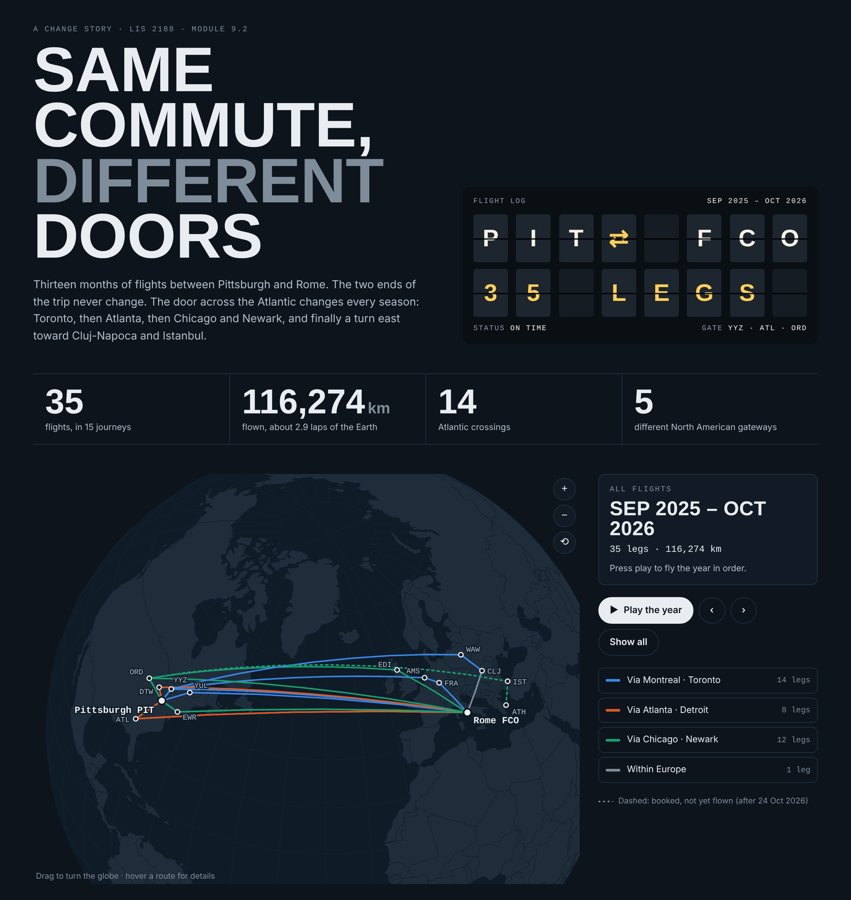
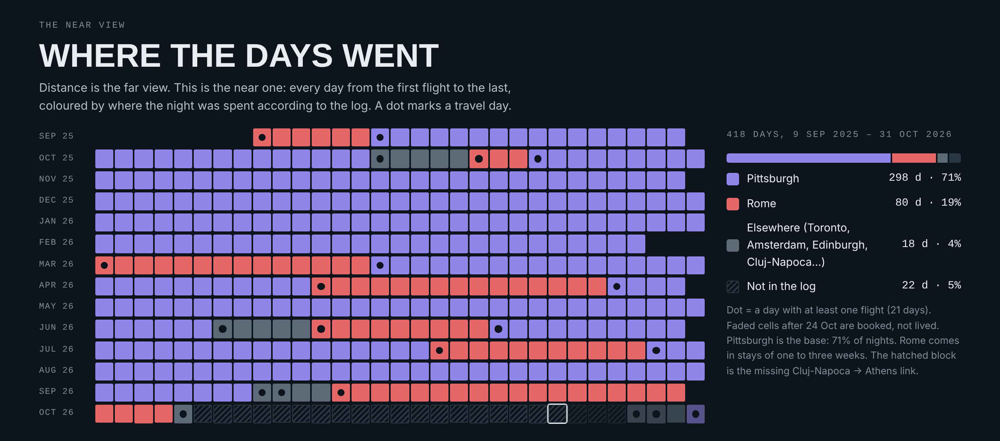

# Same Commute, Different Doors

An interactive data story about 35 flights between Pittsburgh and Rome, from September 2025 to October 2026.
Made for **LIS 2188, Module 9.2: Telling Stories with Data**.

**Story type:** a change story with a personal layer. The two ends of the trip never change, but the place where it crosses the Atlantic changes every season: Toronto, then Atlanta, then Chicago and Newark, and finally a turn east.

## Open it

- Online: https://enricogrammaroli.github.io/flight-story/
- Offline: download `index.html` and open it in any browser. It's self-contained: data, map, scripts and fonts are all inside the file.

## What's inside

| Path | Contents |
|---|---|
| `index.html` | The interactive page: globe with playback, timeline, four route seasons, whereabouts calendar, data table |
| `data/Flights_DataTable_Rev.xlsx` | Original flight log (35 rows) |
| `data/flights.csv`, `data/flights.json` | Same data plus a `km` column (great-circle distance, haversine formula) |
| `images/` | Static images for sharing |

## Method and limits

- Journeys are consecutive legs that end in Pittsburgh or Rome. Each journey is coloured by the North American airport it passes through.
- Distances are straight great-circle lines between airports, not the paths the aircraft actually flew.
- The log has no link between Cluj-Napoca (5 Oct 2026) and Athens (28 Oct 2026), so those days show as "not in the log".
- The last three flights (28–31 Oct 2026) were still bookings when the page was made.
- No emissions figure is given, because cabin class and aircraft type aren't recorded.

## Credits

Built with [D3.js](https://d3js.org) and [TopoJSON](https://github.com/topojson/topojson). Basemap: [Natural Earth](https://www.naturalearthdata.com) via world-atlas. Fonts: Big Shoulders Display and IBM Plex (SIL Open Font License).
